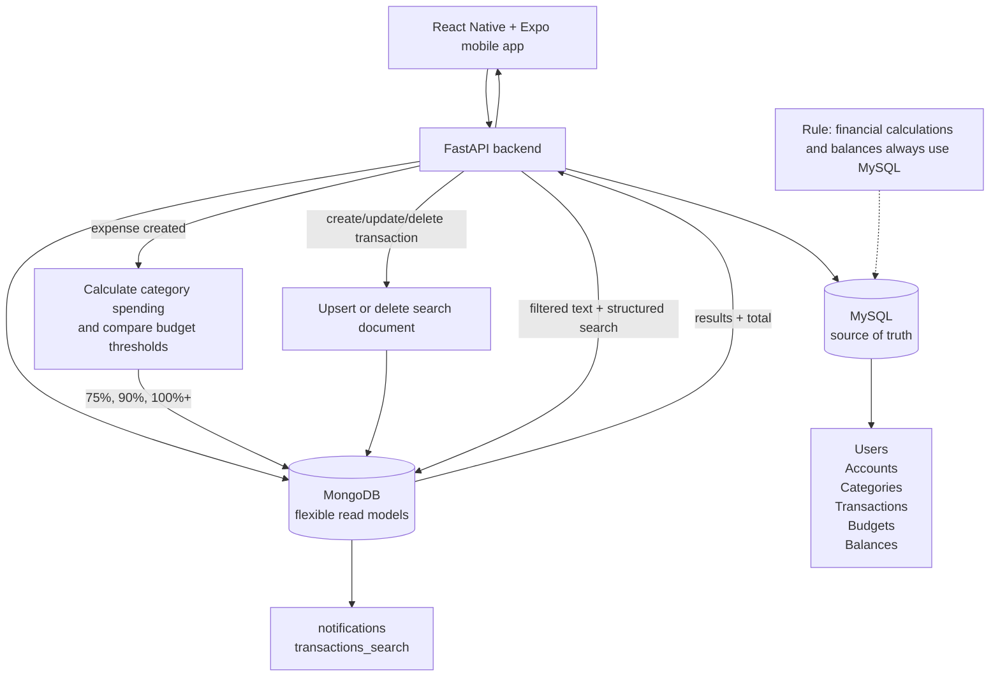

# PennyWise hybrid SQL + NoSQL architecture

## Request flows

1. **Budget alert:** save expense in MySQL → calculate category spending in MySQL → write a flexible alert document to MongoDB → show it in the notification centre.
2. **Transaction search:** synchronize the transaction read model → query MongoDB text and field indexes → return matching records and total expense.
3. **Fallback:** when MongoDB is not configured, the backend falls back to MySQL notification storage and SQL `LIKE` transaction search.
