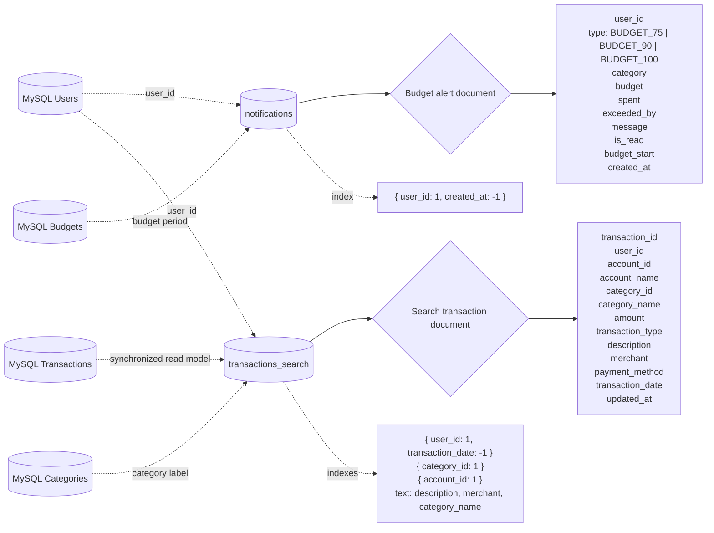

# PennyWise MongoDB document model

MongoDB is document-oriented, so this diagram shows collection ownership, document references, and indexes rather than foreign-key relationships.



## Notification document example

```json
{
  "user_id": 7,
  "type": "BUDGET_90",
  "category": "Food",
  "budget": 1000,
  "spent": 900,
  "exceeded_by": 0,
  "message": "You have used 90% of your Food budget.",
  "is_read": false,
  "budget_start": "2026-11-01",
  "created_at": "2026-11-12T10:30:00Z"
}
```

## Search document example

```json
{
  "transaction_id": 481,
  "user_id": 7,
  "account_id": 3,
  "category_id": 5,
  "category_name": "Food",
  "amount": 900,
  "transaction_type": "EXPENSE",
  "description": "Dinner with family",
  "merchant": "Local Restaurant",
  "transaction_date": "2026-11-12T19:45:00Z",
  "updated_at": "2026-11-12T19:46:00Z"
}
```
