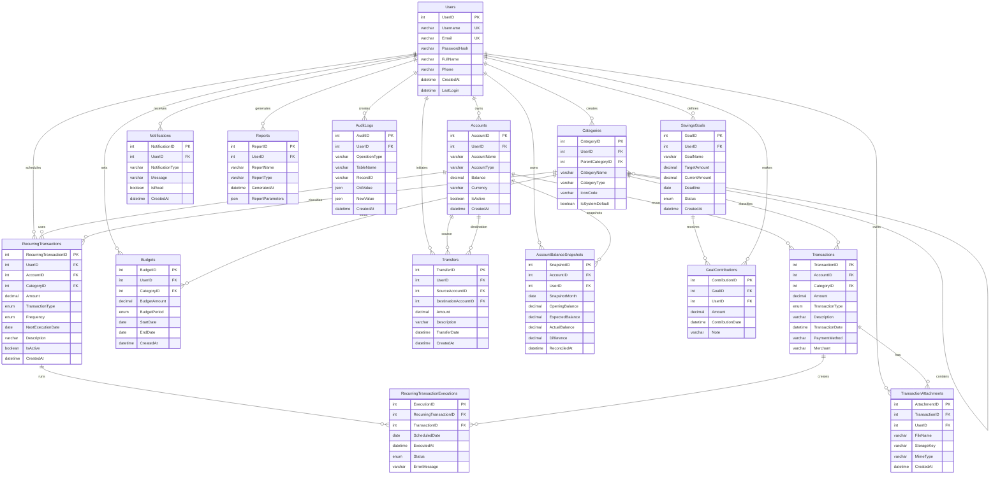

# PennyWise MySQL ER diagram

`Reports.ReportParameters`, `AuditLogs.OldValue`, and `AuditLogs.NewValue` are JSON columns inside MySQL for flexible metadata; they do not replace the relational model.
